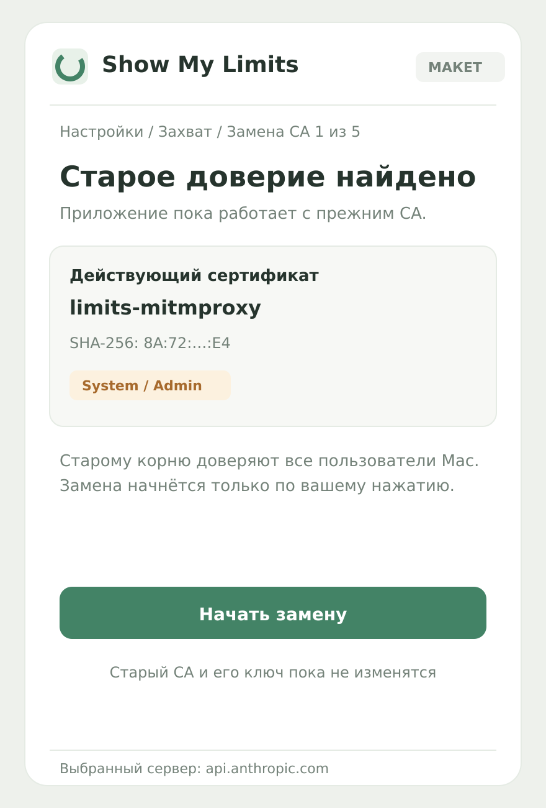
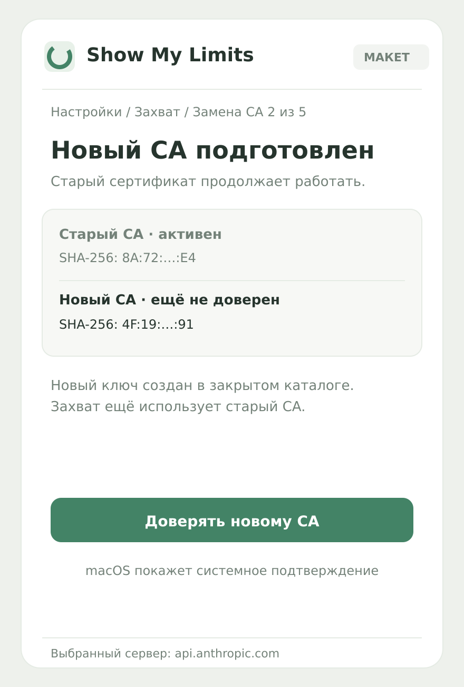
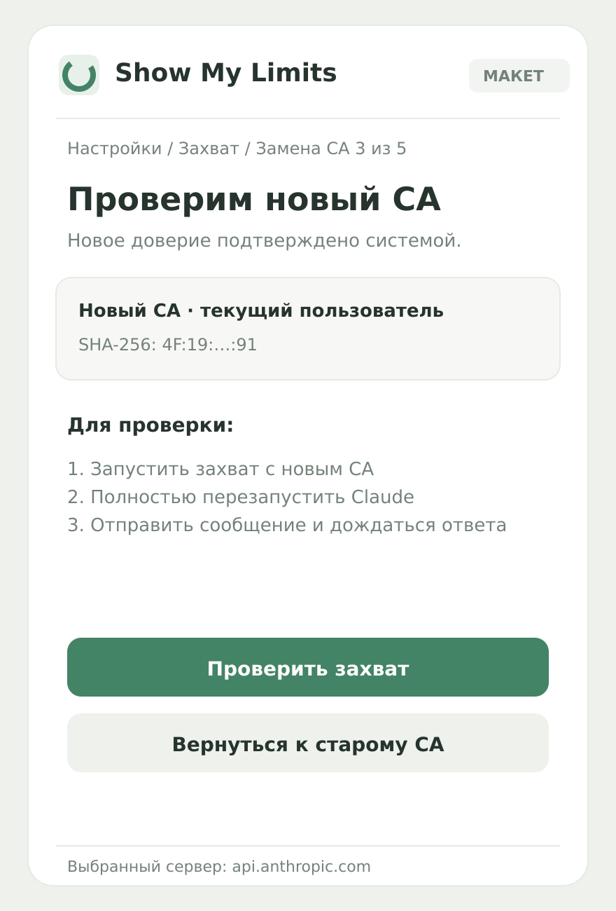
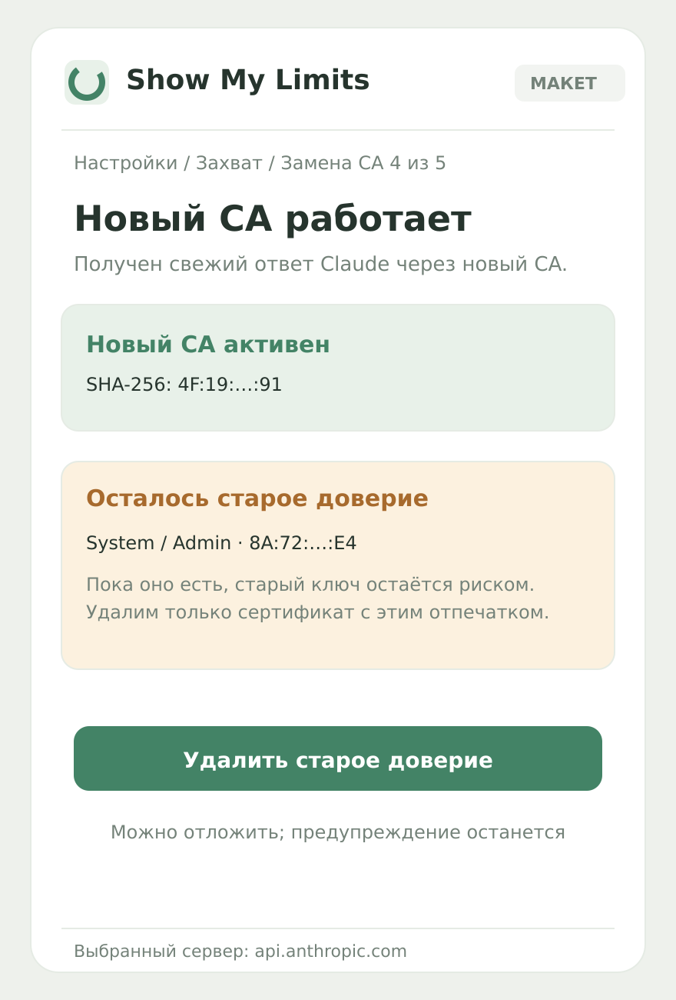
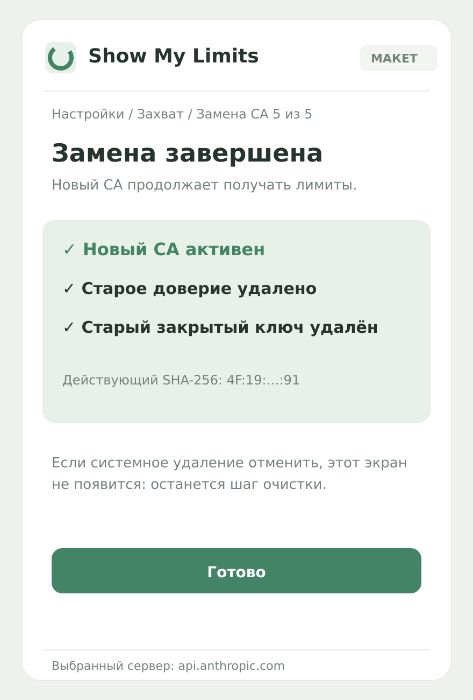

# Макет замены локального CA

Это визуальный сценарий для обсуждения, **не реализованная функция**. Примеры отпечатков вымышлены. Обновление приложения не создаёт новый CA и не меняет существующее доверие автоматически.

## 1. Обнаружение старого доверия

Показываем точный отпечаток действующего CA и область доверия. До явного действия пользователя приложение продолжает работать как раньше.

## 2. Создание нового CA

Новый ключ создаётся в отдельном закрытом каталоге. Старый CA остаётся активным, пока пользователь настраивает доверие к новому.

## 3. Проверка

После подтверждения доверия ОС запускаем временный захват с новым CA. Требуем свежий ответ клиента через новый запуск; при ошибке доступен возврат к старому CA.

## 4. Очистка старого доверия

Новый CA становится постоянным только после успешной проверки. Удаление старого доверия — отдельный явный шаг с точным отпечатком. Отмена оставляет заметное предупреждение.

## 5. Завершение

Показываем успех только после проверки удаления старого доверия и закрытого ключа. Если системное подтверждение отменено, возвращаем пользователя к шагу 4.

На macOS новый CA должен получать доверие текущего пользователя; удаление старого System/Admin потребует системного подтверждения. Windows использует Current User Root. На Linux текущие инструкции устанавливают доверие системно; безопасный пользовательский способ для целевых клиентов ещё нужно проверить до реализации этого шага. Ограничения имён в корневом CA также нельзя обещать до проверки реальных клиентов. См. [план безопасности](SECURITY.md).
